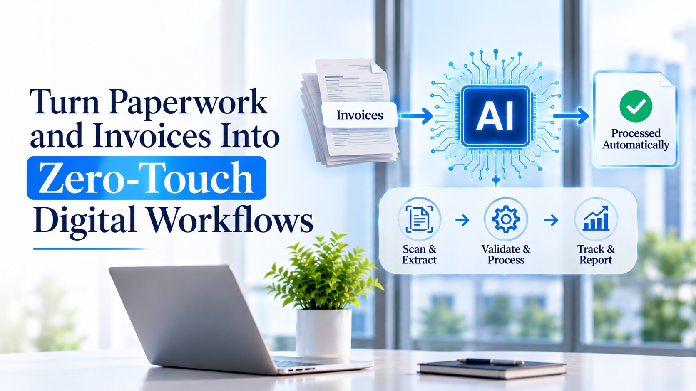

# Turn Paperwork and Invoices Into Zero-Touch Digital Workflows

Every finance, procurement, and operations team knows the pile: invoices in inboxes, forms in scans, approvals chasing people across departments. Each document is typed, checked, and forwarded by hand. The work is slow, repetitive, and a quiet source of errors.

Teams that fix this usually adopt [intelligent business process automation](https://zignuts.com/ai-services/ai-workflow-automation/intelligent-process-automation-services?utm_source=seo_web2.0&utm_medium=backlink&utm_campaign=seo_referral&utm_id=11) to read documents, check them against business rules, and route them without anyone touching the routine ones. Read the full guide online: https://harshp-zigs.github.io/bpa-document-processing-pipeline/

The goal is not to remove people. It is to make sure people only see the documents that genuinely need judgment.

---

## Six Stages From Paper to Posted

| # | Stage | What happens |
|---|---|---|
| 01 | **Capture** | Email, upload, scan, or portal land in one queue with the original stored |
| 02 | **Classify** | Invoice, purchase order, receipt, or form. The type picks the rules |
| 03 | **Extract** | Vendor, dates, line items, and totals as fields with confidence scores |
| 04 | **Validate** | Formats, required fields, duplicates, and known vendors |
| 05 | **Match and route** | Compare with orders and receipts, then route by amount and department |
| 06 | **Post and archive** | Write to the system of record with an audit trail |

## Three-Way Matching

| Compare | Against | If it does not match |
|---|---|---|
| Invoice lines | Purchase order lines | Flag price or quantity variance |
| Invoiced quantity | Goods or service receipt | Hold until receipt is recorded |
| Vendor and bank details | Vendor master record | Send to verification |
| Invoice number and amount | Previously processed items | Block as possible duplicate |

Tolerances are business decisions. Set them with finance, not with the tool.

## Exceptions Are the Design

- **Low confidence:** show the document beside the extracted field for a one-click fix.
- **Rule failure:** state which rule failed and why.
- **Learning loop:** feed corrections back so the same exception is rarer next month.

## What to Measure

| Metric | Meaning |
|---|---|
| Straight-through rate | Share of documents posted with no human touch |
| Cycle time | Receipt to posting, by document type |
| Exception rate | Share routed to review, and top causes |
| Correction rate | How often reviewers change extracted values |
| Duplicate catches | Items blocked before payment |

Capture a baseline first so improvement is shown with your own numbers.

## Rollout Checklist

- [ ] Start with one high-volume document type
- [ ] Collect a representative sample, including messy scans
- [ ] Agree match tolerances and approval limits with finance
- [ ] Run in shadow mode and compare with manual results
- [ ] Link the original document to every posted record
- [ ] Restrict who can change rules, vendors, and bank details
- [ ] Review exceptions weekly and tune from real corrections

## Repository Contents

| File | Purpose |
|---|---|
| `index.html` | The article page |
| `style.css` | Page styles |
| `sitemap.xml` | Sitemap for search engines |
| `robots.txt` | Crawler rules |

---

**Ready to retire the paper pile?** Visit [zignuts.com](https://zignuts.com/?utm_source=seo_web2.0&utm_medium=backlink&utm_campaign=seo_referral&utm_id=11) to talk to the team.
